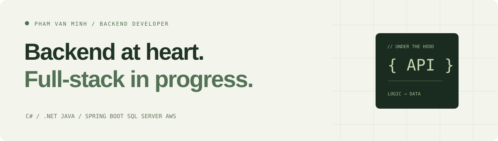

<picture>
  <source media="(prefers-color-scheme: dark)" srcset="assets/header-dark.svg">
  <source media="(prefers-color-scheme: light)" srcset="assets/header-light.svg">
  
</picture>

### Hi, I'm Minh

I'm a final-year **Software Engineering student at FPT University**, preparing for my graduation project. I enjoy working with servers, APIs, and the logic that connects a product to its data.

My focus is **Backend development with .NET and Spring Boot**. I completed a three-month **AWS First Cloud AI Journey internship** and received a completion certificate. I'm continuing to explore cloud and frontend development as I grow toward Full-stack.

[English CV](resources/CV-EN.pdf) · [CV tiếng Việt](resources/CV-VI.pdf) · [LinkedIn](https://www.linkedin.com/in/charlie-minh-182914302/) · [Email](mailto:phamvanminh150204@gmail.com)

### Selected work

| Project | What to explore | Stack |
| --- | --- | --- |
| [EV Battery Swap Station Management](https://github.com/CharlieMinh/EV-Battery-Swap-Station-Management-System-Backend) | Station operations, reservations, inventory, subscriptions, payment integration | ASP.NET Core 9, EF Core, SQL Server, SignalR, VNPay |
| [HIV Treatment Management](https://github.com/fpt-swp391-sum25/hiv-treatment-backend) | Academic team project for doctor schedules, appointments and test result tracking | Java, Spring Boot, Spring Security, JWT, SQL Server |
| [Scientific Journal Management](https://github.com/CharlieMinh/Project_PRN222_ScientificJournal) | Layered .NET application with journal and paper data models | C#, ASP.NET MVC, Entity Framework |
| [AWS FCJ Worklog](https://github.com/CharlieMinh/fcj-worklog) | Bilingual notes, cloud practice, architecture proposals and workshop documentation | AWS, Hugo, Markdown |

### Tools I work with

| Focus | Technologies |
| --- | --- |
| Backend | C# · ASP.NET Core · Entity Framework Core · Java · Spring Boot · Spring Security |
| Data & integration | SQL Server · REST APIs · JWT · SignalR · VNPay |
| Workflow | Git · GitHub · Postman · Visual Studio · IntelliJ IDEA |
| Cloud practice | AWS IAM · VPC · EC2 · S3 · RDS |
| Growing into | React · HTML/CSS · Application deployment · Full-stack development |

### What I'm building toward

- A deeper understanding of backend workflows, data consistency, and authentication.
- Better documentation that makes a project's architecture and tradeoffs easy to understand.
- Connecting backend, frontend, and cloud skills through my graduation project.

<strong>Tiếng Việt · Một chút về mình</strong>

### Chào bạn, mình là Minh

Mình là sinh viên **cuối năm 4 ngành Kỹ thuật phần mềm tại FPT University**, đang chuẩn bị làm đồ án tốt nghiệp. Mình thích làm việc với server và tìm hiểu cách API, nghiệp vụ và dữ liệu kết nối với nhau.

Mình lấy **Backend với .NET và Spring Boot** làm trọng tâm. Sau **3 tháng thực tập AWS First Cloud AI Journey**, đã có chứng nhận hoàn thành, mình tiếp tục học cloud và frontend để từng bước phát triển theo hướng Full-stack.

Các repository phía trên ghi lại những dự án và quá trình học của mình: hệ thống đổi pin bằng .NET, dự án nhóm quản lý điều trị bằng Spring Boot, ứng dụng tạp chí khoa học và nhật ký AWS song ngữ.

Mình mong được trao đổi về cơ hội Backend, cùng học hỏi và xây dựng những sản phẩm có ích.

[CV tiếng Việt](resources/CV-VI.pdf) · [Liên hệ qua email](mailto:phamvanminh150204@gmail.com)

---

Ho Chi Minh City, Vietnam · Curious about how things work. Always learning.
